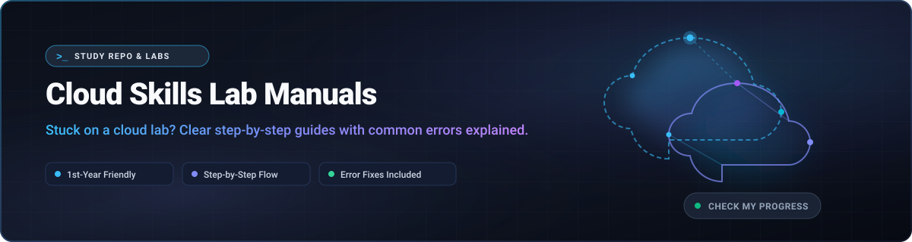

  

<h1 align="center">Cloud Skills Lab Manuals</h1>

  <strong>Stuck on a cloud lab? Clear step-by-step guides with the common errors explained.</strong>

  
  
  
  

---

## What is this?

Beginner-friendly, step-by-step manuals for Google Cloud Skills Boost challenge labs, written for anyone with zero cloud experience.

Every guide explains what the cloud commands actually do behind the scenes, breaks complex objectives into single verifiable steps, and highlights the exact pitfalls where students usually get stuck.

---

## How to use these guides

1. **Start the lab and read your own values:** Look at the left panel and instruction text on your live lab page to find your specific Project ID, Region, Zone, and resource names.
2. **Keep the guide open beside Cloud Shell:** Arrange your browser with the guide on one side and the Google Cloud Console on the other.
3. **Run ONE command block at a time:** Execute commands sequentially and verify that the output matches what is expected before moving forward.
4. **Click "Check my progress" after each task:** Never wait until the end. Verify each checkpoint as soon as you finish its corresponding steps.

> [!IMPORTANT]
> ### Golden Rules
> - **Know WHERE you are typing:** Double check whether you are running a command in Cloud Shell or inside a remote SSH session on a virtual machine (VM).
> - **Variables disappear when Cloud Shell reconnects:** If your terminal disconnects or refreshes, environment variables like `$PROJECT_ID`, `$REGION`, or `$ZONE` are lost. Re-export them before running further commands.
> - **Check the output before uploading or clicking Check:** Confirm that commands completed without errors and that services are in an active state before requesting progress validation.
> - **Values differ per student:** Resource names, zones, regions, and project IDs are dynamically generated per lab session—never copy someone else's names or credentials.

---

## Lab Index

> Labs are ordered by study sequence. **Lab 1** is ARC120, **Lab 2** is ARC134, **Lab 3** is ARC132, **Lab 4** is GSP529, **Lab 5** is ARC122, **Lab 6** is GSP319, **#7** is the Gemini Enterprise Assessment, and **Lab 8** is ARC100. All eight are verified and tested!

| # | Lab ID | Lab Name | Skills Covered | Status |
|:---:|:---|:---|:---|:---:|
| 1 | [ARC120](labs/arc120.md) | The Basics of Google Cloud Compute | Storage bucket, VM instance, persistent disk, NGINX installation | ✅ Verified |
| 2 | [ARC134](labs/arc134.md) | Configure Service Accounts and IAM Roles | Custom IAM roles, service accounts, BigQuery access controls | ✅ Verified |
| 3 | [ARC132](labs/arc132.md) | Implement Speech and Language Solutions with Pre-trained APIs | Text-to-Speech, Speech-to-Text, Cloud Translation | ✅ Verified |
| 4 | [GSP529](labs/gsp529.md) | Develop AI-Powered Prototypes in Google AI Studio | Prompt engineering, multimodal prototypes, Gemini API | ✅ Verified |
| 5 | [ARC122](labs/arc122.md) | Analyze Images with the Cloud Vision API | Vision API, text detection, landmark detection | ✅ Verified |
| 6 | [GSP319](labs/gsp319.md) | Build a Website on Google Cloud | Google Kubernetes Engine (GKE), microservices deployment | ✅ Verified |
| 7 | [Gemini Assessment](assessments/gemini-enterprise-assessment.md) | Create Your First Gemini Enterprise Application | Enterprise RAG, periodic sync, deep research, multimodal reasoning | ✅ Verified |
| 8 | [ARC100](labs/arc100.md) | Store, Process, and Manage Data on Google Cloud | Cloud Storage buckets, Pub/Sub topics, Cloud Run functions | ✅ Verified |
| — | ARC131 | Using the Google Cloud Speech API | Speech-to-Text API, audio transcription, request JSONs | ⏳ Planned |
| — | GSP659 | Deploy Your Website on Cloud Run | Cloud Run, container image deployment, service scaling | ⏳ Planned |

> [!WARNING]
> **Known lab bug for ARC131:** At the time of writing, certain file parameters in the lab page may display as unrendered `{{{placeholders}}}`. Refer to the guidance in the manual once published.

---

## Course Assessments

Step-by-step guides for Google Cloud Skills Boost course assessments and certification knowledge checks:

| Assessment | Focus Topics | Questions | Status |
|:---|:---|:---:|:---:|
| [Create Your First Gemini Enterprise Application](assessments/gemini-enterprise-assessment.md) | Enterprise RAG, periodic data sync, deep research agents, multimodal analysis | 8 confirmed Q&As | ✅ Verified |

---

## Status Legend

| Status | Meaning |
|:---:|:---|
| ✅ Verified | Lab manual has been verified end-to-end on a live session and confirmed working. |
| 🟡 Draft | Lab manual is written with step-by-step commands and troubleshooting, awaiting fresh live verification. |
| ⏳ Planned | Scheduled on the roadmap; manual has not yet been authored. |

---

## Frequently Asked Questions

<strong>Why do values differ between students?</strong>

 
Google Cloud Skills Boost spins up a brand-new, isolated cloud project for every single student attempt. To prevent naming collisions across thousands of concurrent learners, project IDs, designated compute zones, and bucket suffixes are dynamically generated at launch. Always read your specific parameters directly from your lab's active panel.

<strong>What if "Check my progress" stays red?</strong>

 
Don't panic! Here is how to diagnose it:
1. **Wait 30 to 60 seconds:** Background telemetry and assessment checkers often have slight propagation delays.
2. **Review your values:** Verify that your bucket name, instance name, or zone matched the requirements exactly (character by character).
3. **Inspect the manual's Troubleshooting table:** Check the troubleshooting section at the bottom of the lab guide for specific CLI inspection commands (e.g. `gcloud compute instances describe`).

<strong>Why do I see {{{placeholders}}} in a lab?</strong>

 
Occasionally, Google's markdown templating engine fails to substitute dynamic variables in the lab instructions, leaving raw placeholders like `{{{project_id}}}` or `{{{filename}}}` on screen. If you encounter this, try refreshing the lab page or contact Google Cloud Skills Boost Support directly via the in-lab chat button.

---

## Roadmap

Upcoming labs and verified releases (in sequence):

- [x] **Lab 1:** [ARC120](labs/arc120.md) — The Basics of Google Cloud Compute (✅ Verified)
- [x] **Lab 2:** [ARC134](labs/arc134.md) — Configure Service Accounts and IAM Roles (✅ Verified)
- [x] **Lab 3:** [ARC132](labs/arc132.md) — Implement Speech and Language Solutions with Pre-trained APIs (✅ Verified)
- [x] **Lab 4:** [GSP529](labs/gsp529.md) — Develop AI-Powered Prototypes in Google AI Studio (✅ Verified)
- [x] **Lab 5:** [ARC122](labs/arc122.md) — Analyze Images with the Cloud Vision API (✅ Verified)
- [x] **Lab 6:** [GSP319](labs/gsp319.md) — Build a Website on Google Cloud (✅ Verified)
- [x] **#7:** [Gemini Enterprise Assessment](assessments/gemini-enterprise-assessment.md) — Course Assessment (✅ Verified)
- [x] **Lab 8:** [ARC100](labs/arc100.md) — Store, Process, and Manage Data on Google Cloud (✅ Verified)
- [ ] Add ARC131: Using the Google Cloud Speech API
- [ ] Add GSP659: Deploy Your Website on Cloud Run

---

## Disclaimer

> [!NOTE]
> This project is an independent, unofficial study guide created purely for educational practice and peer learning. It is not affiliated with, sponsored by, or endorsed by Google or Google Cloud Skills Boost.
>
> Cloud interfaces, SDK syntax, and lab tasks evolve over time. Your active lab page remains the single source of truth. Always attempt the lab exercises yourself first and consult these manuals only when stuck.

---

## Community & Contributing

Found a typo or a broken step? Want to help write a planned lab? We welcome contributions!

- Read our [Contributing Guide](CONTRIBUTING.md) to get started.

---

## Author & Maintainer

Crafted, verified, and maintained with ❤️ by [**saurabhkun** on GitHub](https://github.com/saurabhkun) :)

If these guides helped you pass your challenge labs, don't forget to ⭐ star the repository!
